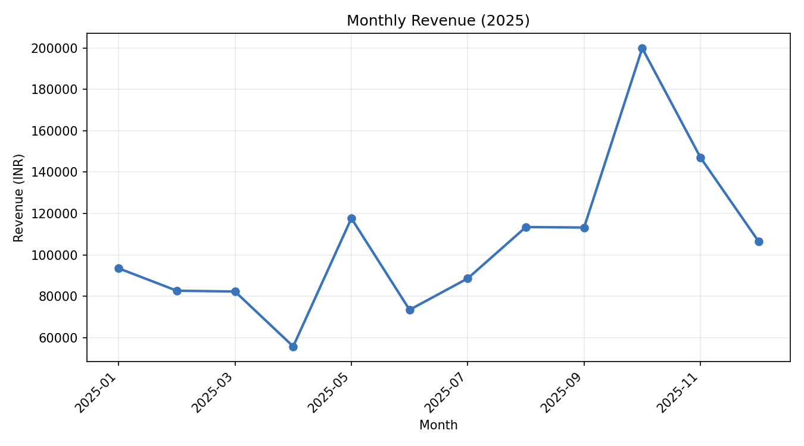
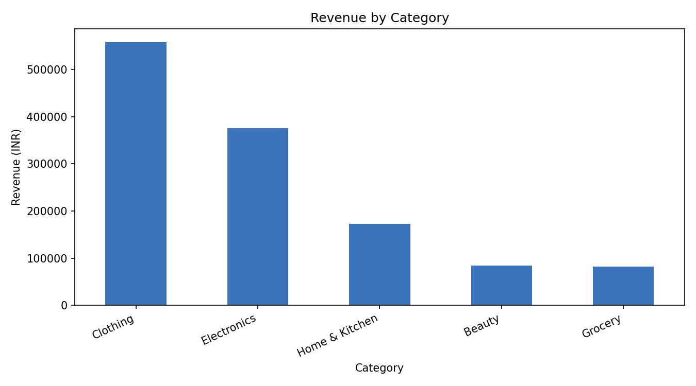
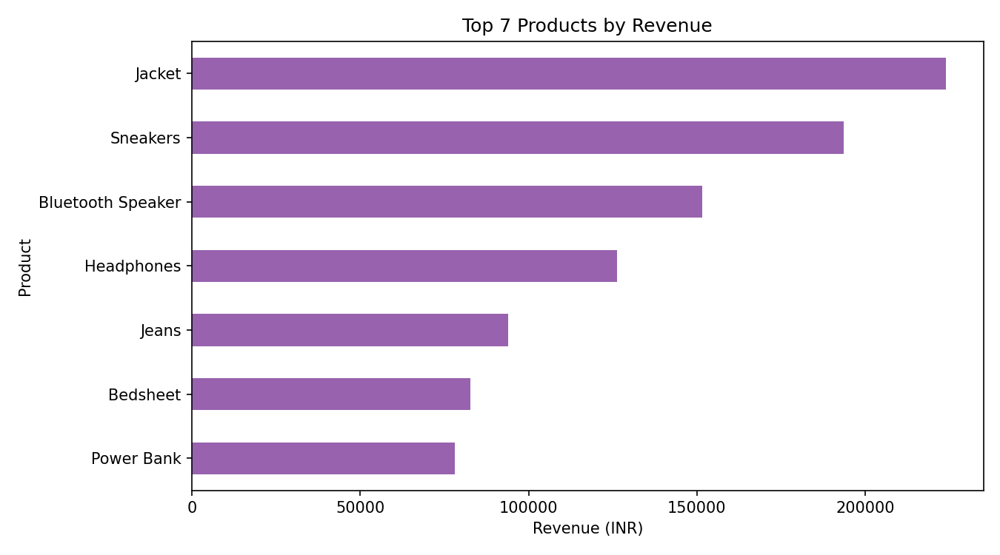
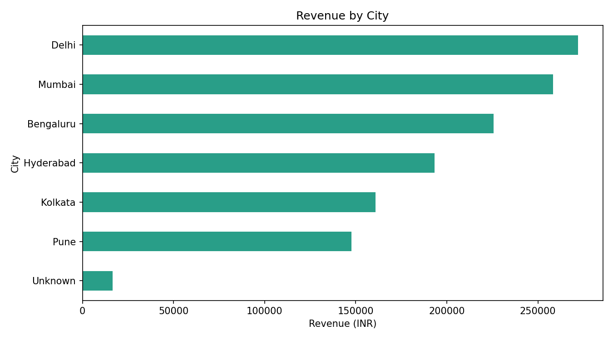
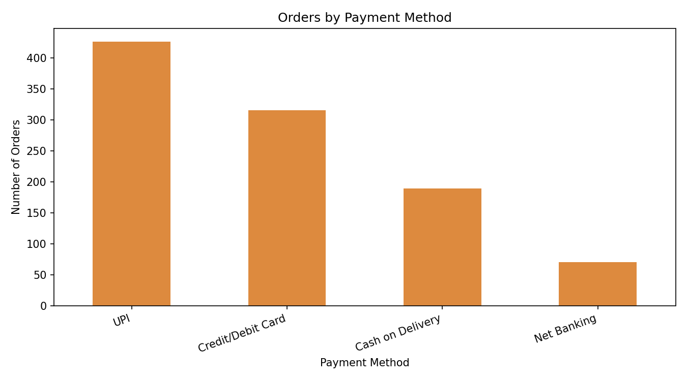

# Retail Sales Performance Analysis

**An end-to-end exploratory data analysis project using Python, Pandas, and Matplotlib**

## Project overview

A retail business generates transaction data every day, but raw sales records alone do not answer questions such as *Which product categories drive revenue?* or *When are sales strongest?*

In this project, I analyzed a retail transaction dataset covering **January–December 2025**. I cleaned the raw records, calculated revenue, explored sales patterns across categories, products, cities, and months, and visualized the results to identify possible business opportunities.

**Goal:** Turn raw transactional data into clear, reproducible insights that a retail team could use to guide further investigation.

### At a glance

| Metric | Result |
|:--|--:|
| Total revenue | **₹12,74,490.40** |
| Orders analyzed | **1,000** |
| Units sold | **1,529** |
| Average order value | **₹1,274.49** |
| Highest-revenue category | **Clothing** |
| Highest-revenue month | **October 2025** |

## Business questions

The analysis is organized around five questions:

1. How much revenue did the store generate, and what was its average order value?
2. Which product categories and individual products contributed the most revenue?
3. How did revenue change from month to month?
4. Which cities accounted for the most revenue?
5. Which payment methods were used most often?

## Tools and techniques

| Tool | Purpose |
|:--|:--|
| **Python** | Analysis workflow and calculations |
| **Pandas** | Data inspection, cleaning, transformations, and aggregation |
| **Matplotlib** | Bar charts, horizontal bar charts, and a monthly trend line |
| **Jupyter Notebook** | Step-by-step analysis with explanations and outputs |
| **SQL (optional)** | Query practice on the same CSV dataset using SQLite |

**Techniques practiced:** missing-value treatment, duplicate removal, date parsing, feature engineering, `groupby()`, aggregation, sorting, KPI calculation, and exploratory data visualization.

## Dataset

- **Source:** Programmatically generated, fictional retail transactions (`retail_sales.csv`)
- **Time period:** January 1–December 31, 2025
- **Raw size:** 1,012 rows × 9 columns
- **After cleaning:** 1,000 records, representing 1,000 unique orders
- **Currency:** Indian rupees (INR)

### Data dictionary

| Column | Description |
|:--|:--|
| `Order_ID` | Order identifier |
| `Order_Date` | Transaction date (`YYYY-MM-DD`) |
| `City` | City associated with the order |
| `Category` | Product category |
| `Product` | Product name |
| `Quantity` | Number of units purchased |
| `Unit_Price_INR` | Listed price per unit in INR |
| `Discount_Pct` | Discount applied, in percent |
| `Payment_Method` | Payment method used |

The analysis creates two additional fields: `Revenue_INR` (net sales after the recorded discount, before any unrecorded costs or returns) and `Month` (`YYYY-MM`) for monthly reporting.

## Analysis workflow

### 1. Inspect the data

Load the CSV with `pd.read_csv()` and inspect its structure, data types, missing values, and duplicate rows.

### 2. Clean the data

| Issue identified | Treatment |
|:--|:--|
| **12 exact duplicate rows** | Removed with `drop_duplicates()` |
| **14 missing city values** | Replaced with `Unknown` rather than guessing a city |
| **9 missing discount values** | Assumed **0% discount** for this learning exercise |
| Date and numeric columns | Converted to appropriate types; invalid entries would be excluded |
| Non-positive quantities/prices or out-of-range discounts | Excluded by validation rules (none additional were removed in this dataset) |

**Why this matters:** These decisions make the analysis repeatable, but the missing-discount assumption can affect revenue totals. It would need business confirmation in a real project.

### 3. Engineer useful fields

Net revenue per row is calculated as:

```python
df["Revenue_INR"] = (
    df["Quantity"] * df["Unit_Price_INR"] *
    (1 - df["Discount_Pct"] / 100)
).round(2)

df["Month"] = df["Order_Date"].dt.to_period("M").astype(str)
```

### 4. Analyze and visualize

Aggregate cleaned transactions by category, month, city, product, and payment method. Export the plots as PNG files in `charts/` so the results are easy to view without opening the notebook.

## Results and visualizations

### Revenue trend across 2025



**October 2025** had the highest recorded revenue, **₹1,99,855.50** (about **15.7%** of annual revenue). The dataset shows a peak, but it does not explain *why* it happened; promotion and seasonality data would be needed to investigate.

### Category and product performance

| Revenue by category | Top 7 products by revenue |
|:--:|:--:|
|  |  |

- **Clothing** generated **₹5,58,537.75**, approximately **43.8%** of total revenue.
- **Electronics** was second with **₹3,75,969.40**, approximately **29.5%**.
- **Jacket** was the highest-revenue individual product, at **₹2,23,866.95**.

These are **revenue** rankings, not profit rankings; product costs are not included.

### Geographic performance and payment preferences

| Revenue by city | Orders by payment method |
|:--:|:--:|
|  |  |

- **Delhi** was the highest-revenue *known* city, generating **₹2,72,017.75**.
- **UPI** was the most frequent payment method, used in **426 of 1,000 orders (42.6%)**.

## What the business could investigate next

The following are **suggested follow-up analyses**, not proven causes or guaranteed recommendations:

1. **Assortment planning:** Review inventory and stockout information for Clothing and high-revenue products such as Jackets.
2. **October revenue spike:** Compare campaigns, discounts, and demand patterns across months to understand the increase.
3. **City-level strategy:** Compare order counts, delivery costs, and customer acquisition by city before deciding where to invest.
4. **Checkout experience:** Review payment failures and checkout abandonment, especially for popular methods such as UPI.
5. **Data quality:** Improve city capture and confirm the policy for missing discount values.


## Limitations

- **Revenue ≠ profit:** Product costs, margins, refunds, taxes, and delivery costs are not available.
- **Missing context:** There is no customer-level, marketing, promotion, or inventory data to explain trends or establish cause and effect.
- **Cleaning assumptions:** Missing discounts were treated as zero, and missing cities were labelled `Unknown`.
- **Dataset size and scope:** One year of data is suitable for practice but not for forecasting business performance reliably.
--